# Northlight OS

**A clean, modern English home screen for China-market Vidda / Hisense TVs and laser projectors, rebuilt on top of CleanYourTV. Version 2.**

> Northlight OS is a community project and is **not made by, affiliated with or endorsed by
> Hisense or Vidda**. "Vidda" and "Hisense" are trademarks of their owners and are used here only to
> say which TVs this is for.

China-market Vidda laser TVs run Android 14 under a Chinese interface, with ads and a Chinese home screen
that English settings do not change. Northlight OS replaces the home screen with its own, in English, using
nothing but Android's own tools: no root, nothing flashed, and everything can be undone.

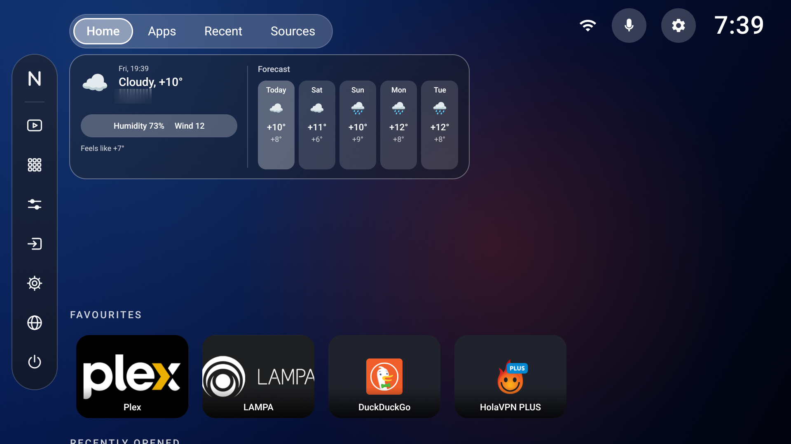

| Apps | Sources |
|---|---|
| 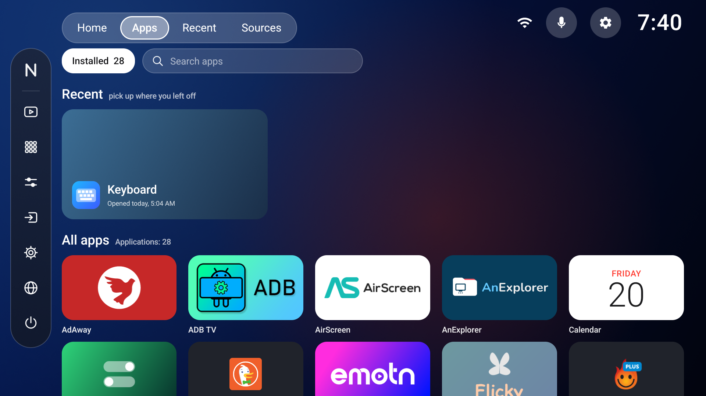 | 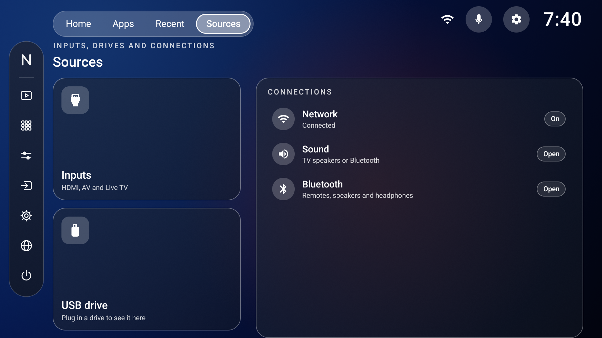 |
| **Short Menu** | **HDMI inputs** |
| 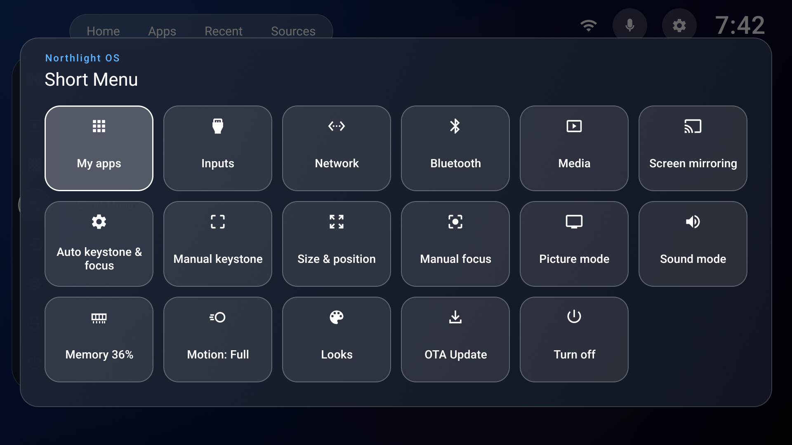 | 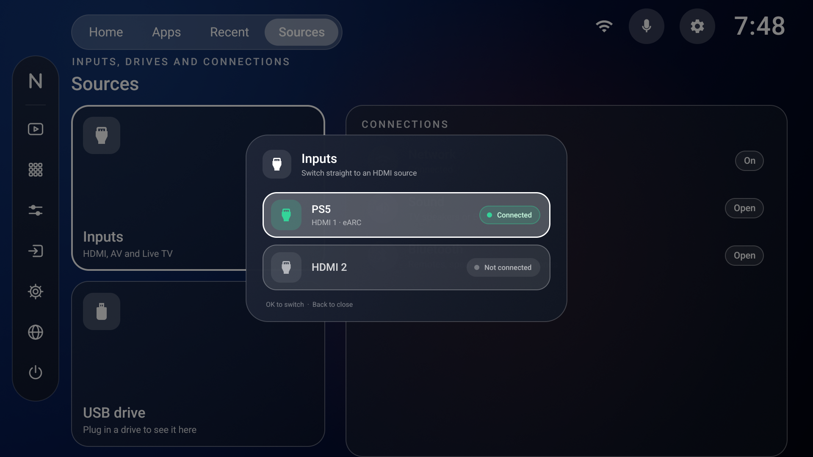 |
| **Quick settings** | **Settings** |
| 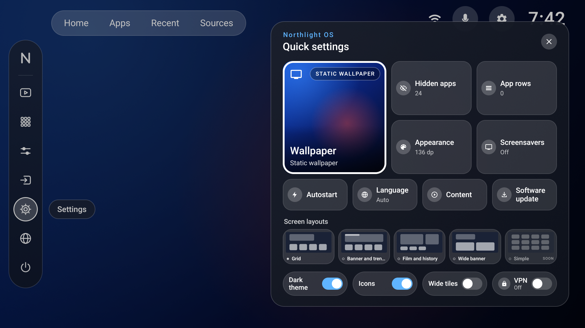 | 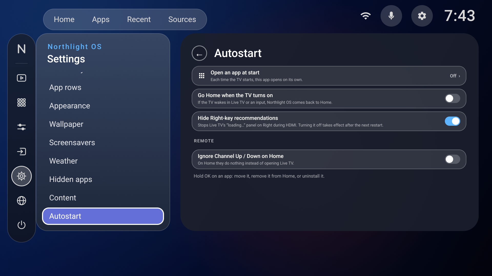 |

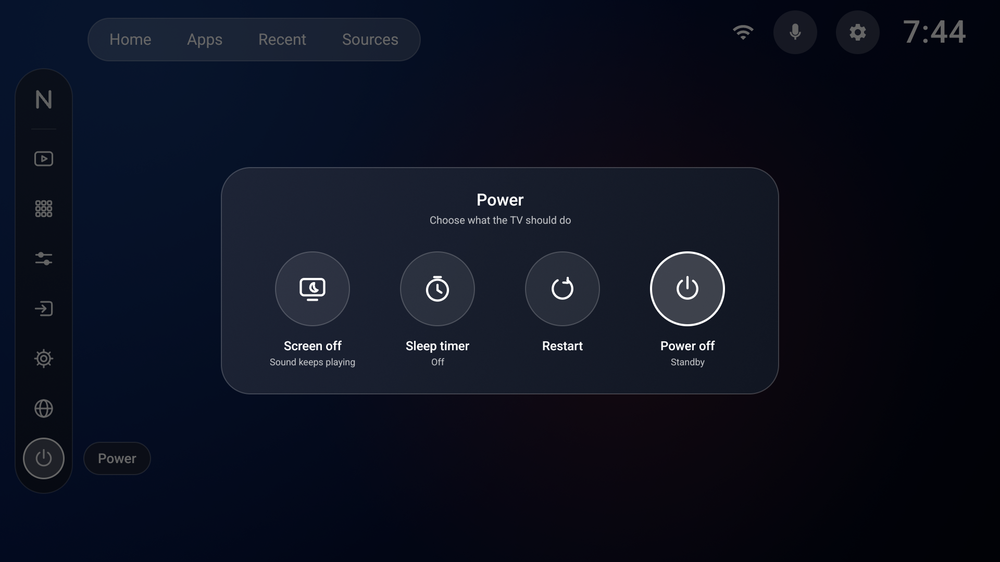

## What's new in version 2

- **Studio**, a new look for Home: a side rail, tabs for Home, Apps, Recent and Sources, a weather card with
  the week ahead, and big favourites. (The original look, **Classic**, is still there; switch in Settings → Theme.)
- **HDMI 1 and HDMI 2 straight from Home**, with each port's live status and the name of the device on it
  (for example "PS5 · HDMI 1 · eARC — Connected"). No Chinese source panel.
- **Short Menu**: the projector's shortcuts in English — keystone, focus, size and position, picture and sound
  mode, Bluetooth, network, screen mirroring and more.
- **Settings in English** for everything Northlight OS does: theme, screen layouts, appearance, wallpaper,
  screensavers, weather, hidden apps, autostart, VPN, language, software update and about.
- **Power menu**: screen off (sound keeps playing), sleep timer, restart and power off.
- **Hide Right-key recommendations**: stops the Chinese "loading…" panel that the Right key opens during HDMI.
- **Search apps**, a **USB media browser**, a **storage usage** page and a home **weather** widget.
- **Add-on apps** (optional): Defaults, Keyboard, Voice, VPN, Themes, Calendar and TV Weather — see below.

## Languages

Northlight OS is available in **31 languages**: English, Arabic, Asturian, Bengali, Catalan, Chinese
(Simplified and Traditional), Czech, Danish, Dutch, Finnish, French, German, Hebrew, Indonesian, Italian,
Korean, Norwegian, Polish, Portuguese (Brazil and Portugal), Russian, Serbian (Latin), Spanish (Spain and Latin
America), Swedish, Thai, Turkish, Ukrainian, Uzbek and Vietnamese.

Translations cover the original home-screen texts; Northlight OS's newer screens (Studio, Short Menu, HDMI
inputs and the new Settings) are in English.

## Add-on apps

Each add-on is its own app; install only the ones you want.

| App | What it does |
|---|---|
| **Defaults** | Sets the TV's default apps (home, keyboard, voice input, screensaver) and lets Northlight OS do what a launcher alone may not: turn apps on or off, restart or power off, rename the TV. Uses the TV's own network debugging; the TV asks once to allow it. |
| **Keyboard** | An English TV keyboard for the remote, with voice typing. |
| **Voice** | Offline English speech recognition for the TV's voice input. Nothing is sent to the internet. |
| **VPN** | A VPN page for the whole TV: shows which VPN app is in charge and its state. |
| **Themes** | Switches Home between Studio and Classic. |
| **Calendar** | A full-screen calendar with day, month and year views. |
| **TV Weather** | Current weather and a 5-day outlook for your city. |

| Defaults | Keyboard |
|---|---|
| 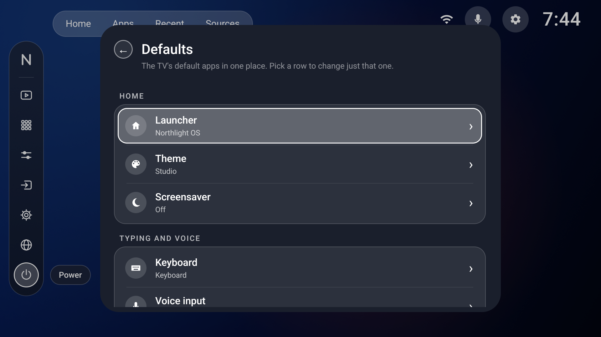 | 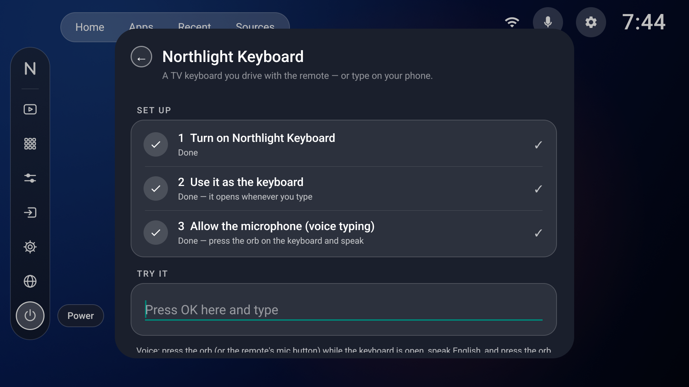 |
| **Voice** | **VPN** |
| 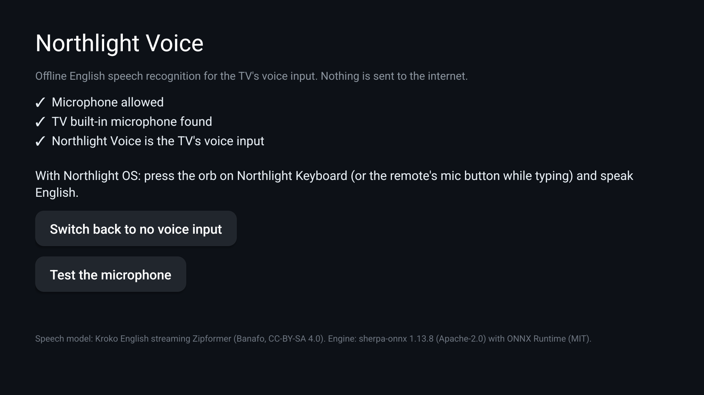 | 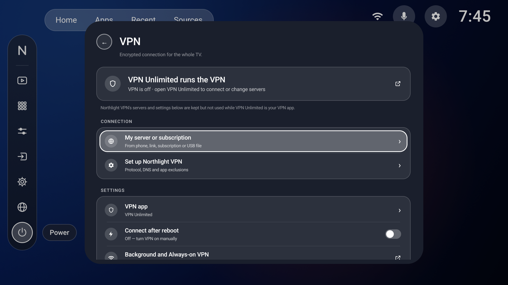 |
| **Themes** | **Calendar** |
| 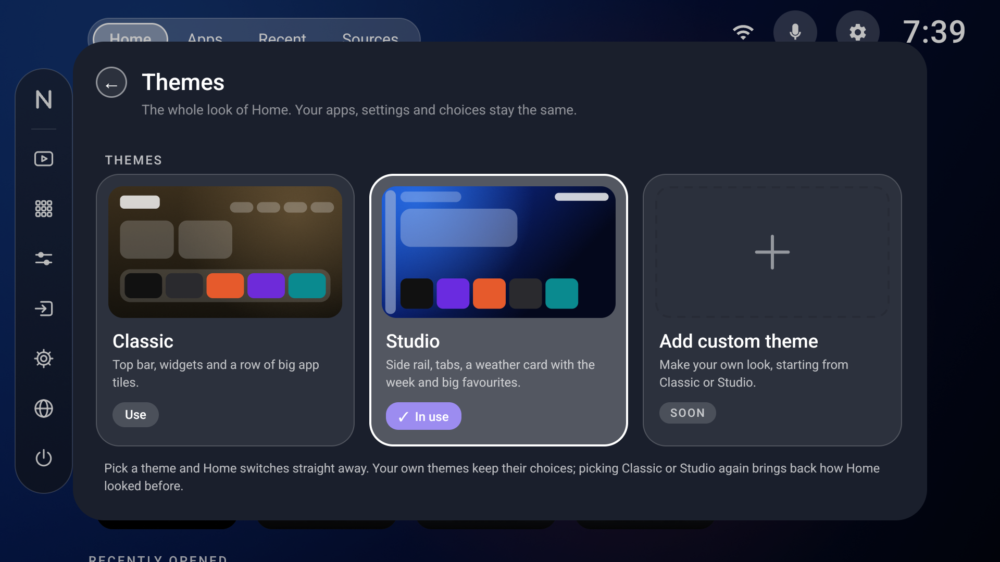 | 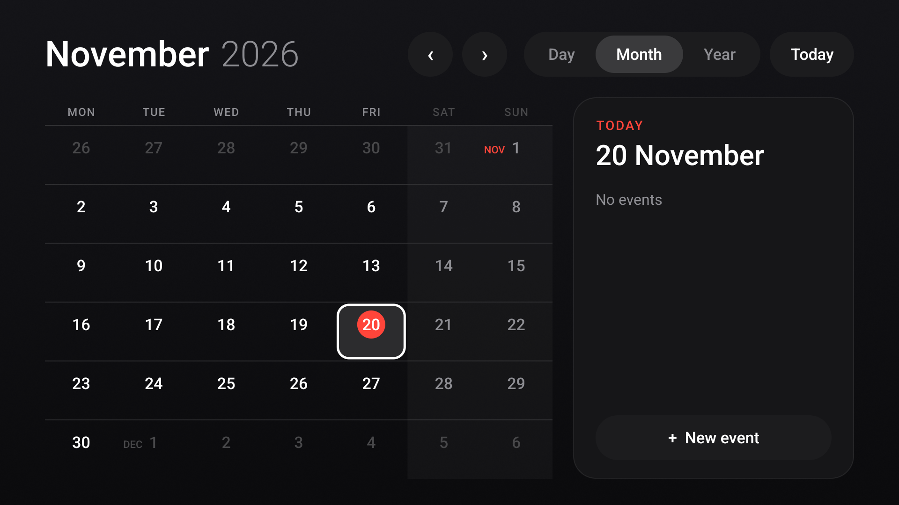 |

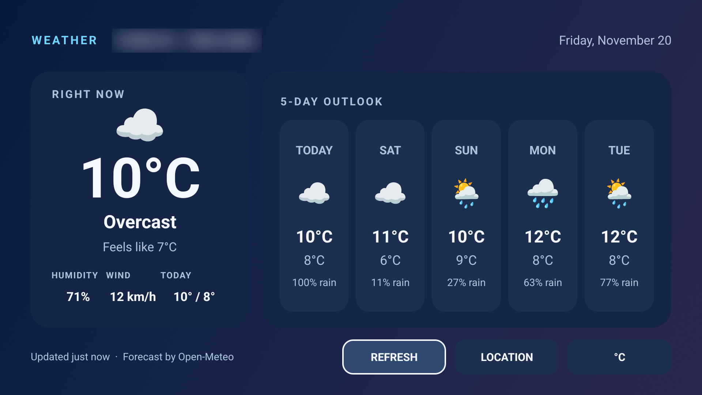

## Tested on

| | |
|---|---|
| TV | Hisense Vidda C3 Ultra laser TV, `ro.build.description` `LASER_MICRO_3DTOF`, China market |
| Board | MediaTek MT9655 (`ro.product.model` `VIDAA_TV`) |
| Android | 14 (API 34), build `UQ1A.240105.004.A1` / `07.02.70.202512281739` |

Version 2 was tested on the Hisense Vidda C3 Ultra. Version 1 was also tested on the Hisense Vidda C1, C2, C3
and C5. Firmware varies by model, so other sets may behave differently.

## Install

You need a Mac or Linux computer with Python 3 on the same network as the TV.

1. **On the TV:** Settings > Device Preferences > About > press OK on **Build** 7 times. Back >
   **Developer options** > **USB debugging** on. Note the TV's IP address (Settings > Network).
2. **If you have version 1** (it was called "VIDDA One" or used the app ID `com.viddaone.launcher`), remove it
   under Android **Settings > Apps** first. Version 2 is a separate app.
3. **Download** `Northlight-OS-2.1.27.apk` from the [Releases](../../releases) page into this folder.
4. **Run:**
   ```bash
   ./northlight-os-setup.sh <tv ip>
   ```
   It installs Northlight OS and makes it Home.
5. **Add-ons (optional):** download the ones you want from the same release and install each with
   `adb install <file>.apk`, or open it from a USB stick with a file manager on the TV.
6. **Switch USB debugging off again** if you don't use the Defaults add-on. On this firmware anyone on your
   network can control the TV while it is on.

Why a script and not just the APK: Hisense's stock home outranks any installed launcher, and only ADB can
switch it off. Installing the APK from a USB stick installs the app but does not make it Home.

Check the download with `shasum -a 256 -c SHA256SUMS.txt` (the file is in the release).

## Undo

```bash
./northlight-os-undo.sh <tv ip>
```

Brings back the stock home and removes Northlight OS. A **factory reset** also undoes everything (and erases
your apps).

## App compatibility

- **Netflix and YouTube work on the author's setup.** Streaming app support can vary by TV, firmware, region
  and app version. Prime Video has not been confirmed on this setup.
- **Some apps that sign in with Google may not work**, because this firmware does not include Google Play
  Services.
- **The remote's quick-panel button** still opens the Chinese panel: the firmware never runs the launcher's
  remote-key helper. Use **Short Menu** on Home.
- **The two Hisense fallback homes** are re-enabled by the firmware at every boot, so Northlight OS leaves them on.
- **Screenshots of HDMI devices** come out black: the TV shows HDMI on a separate video layer.

## Source code

The source in this repository is **version 1**. Version 2 is available as ready-to-install APKs on the
[Releases](../../releases) page.

## Credits

Northlight OS is rebuilt on top of [CleanYourTV](https://github.com/Gathin23/cleanyourtv) by Gathin (MIT),
using its launcher, ADB tools and Hisense MT9655 notes as the foundation. The Voice add-on uses the Kroko
English streaming Zipformer speech model (Banafo, CC-BY-SA 4.0) and [sherpa-onnx](https://github.com/k2-fsa/sherpa-onnx)
(Apache-2.0) with ONNX Runtime (MIT). TV Weather's forecasts come from [Open-Meteo](https://open-meteo.com).

## Licence

cleanyourtv's own code stays under the MIT License. Everything Northlight OS adds or changes is **all rights
reserved**: you may read it, build it and use it on your own TVs, but **changing it and sharing the changed
version, redistributing it, or using the Northlight OS name needs the author's written permission first**. To
ask, open an issue on this repository. Full terms: [LICENSE](LICENSE).
