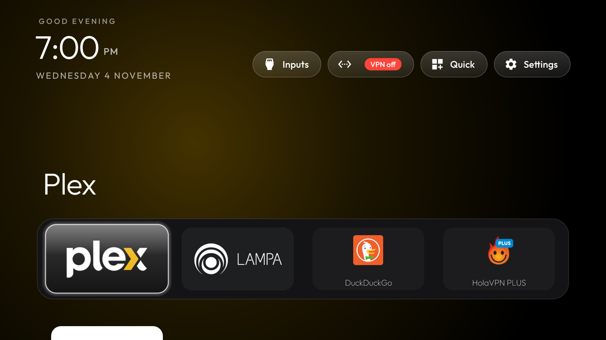
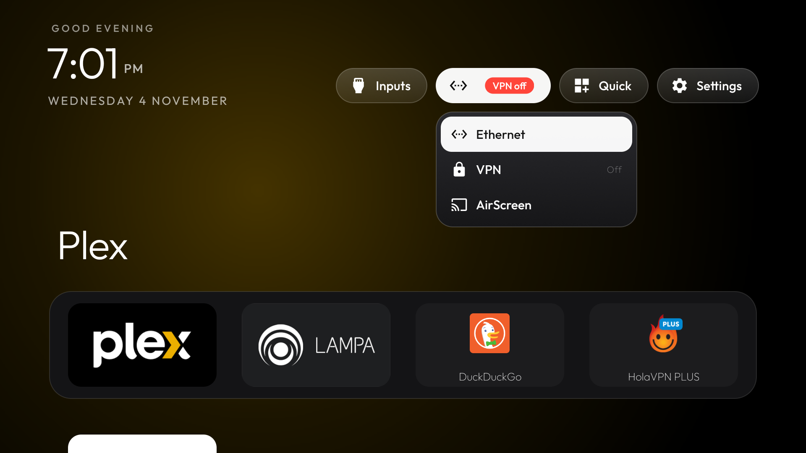
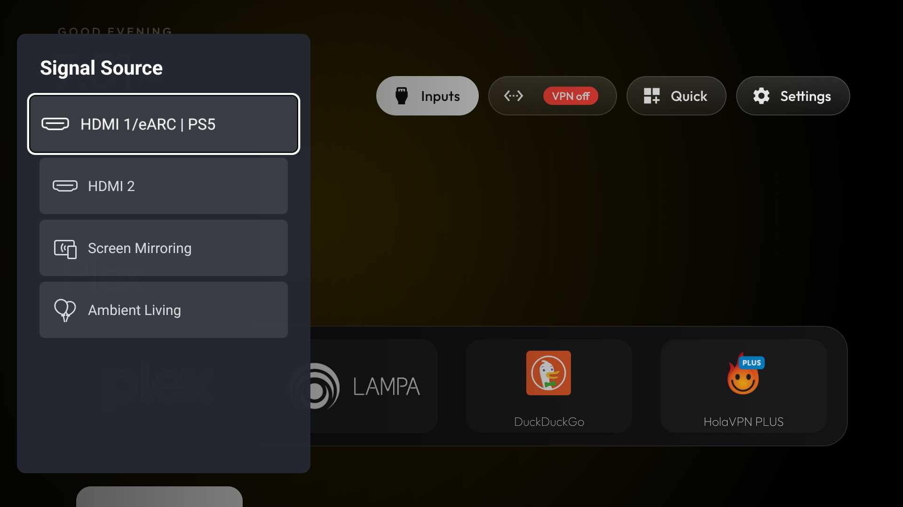
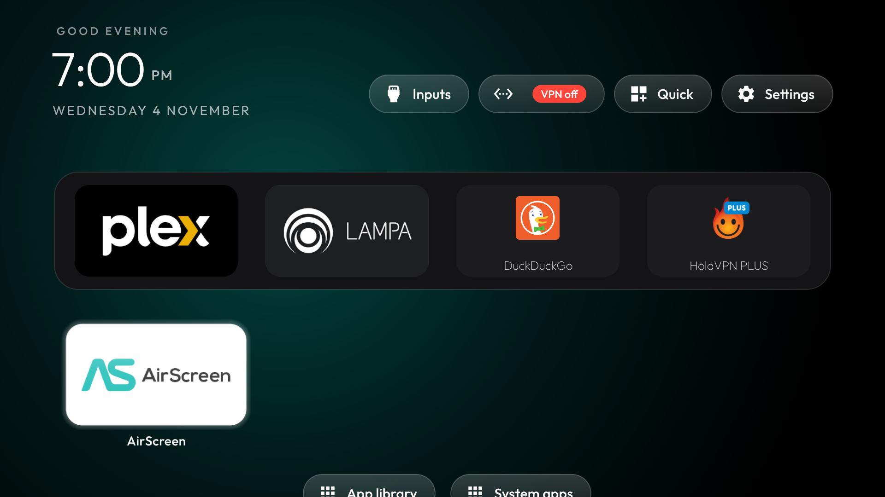
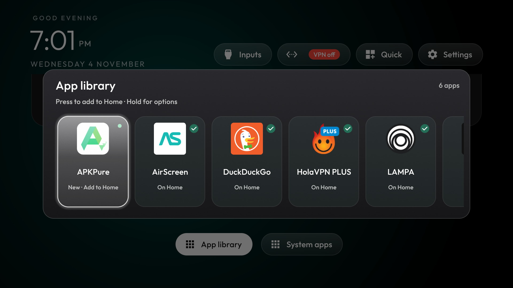
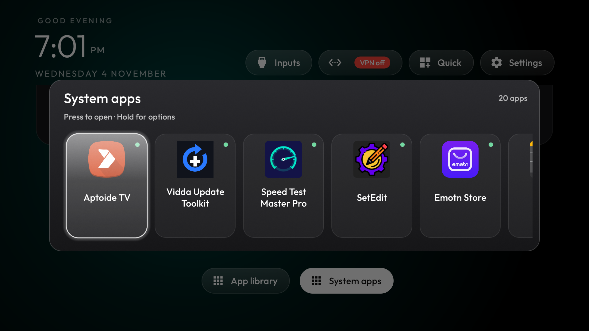

# Northlight OS

**A clean, modern English home screen and debloat kit for China-market Vidda / Hisense TVs and laser projectors, rebuilt on top of CleanYourTV.**

> Northlight OS is a community project and is **not made by, affiliated with or endorsed by
> Hisense or Vidda**. "Vidda" and "Hisense" are trademarks of their owners and are used here only to
> say which TVs this is for.

China-market Vidda laser TVs run Android 14 under a Chinese interface, with ads, telemetry and a
Chinese home screen that English settings do not change. Northlight OS replaces the home screen and turns
off the bloat, using nothing but Android's own tools: no root, nothing flashed, and **everything is
undone by one script or a factory reset**.



| Quick panel | Network and VPN |
|---|---|
|  |  |
| **Inputs** | **App grid** |
|  |  |




## What you get

- **A dark, Apple TV-style home screen in English**: a dock of your favourite apps, a clock, and one
  glass highlight that moves between tiles.
- **Inputs** opens the TV's own Signal Source panel (HDMI, screen mirroring).
- **A network pill with a dropdown** for Ethernet/Wi-Fi settings, your VPN (with an On/Off badge) and
  AirScreen when it is installed.
- **Quick**: an English version of the Chinese quick panel, with Bluetooth, network, screen mirroring,
  auto keystone and focus, manual keystone, manual focus, picture mode and sound mode.
- **App library**: every installed app, phone apps included.
- **System apps**: tools and Chinese system apps kept off Home behind a **PIN (default 0000)**. It keeps
  family out; it is not real security, because the PIN is inside the APK.
- **Boots straight into Northlight OS**, without the stock Chinese "SecondScreen" home.
- **Debloat**: 20 packages for ads, telemetry, push messages, demo/hotel modes, preloads and the Chinese
  voice extras ([debloat.txt](debloat.txt)). Firmware updates, HDMI switching, casting and the laser's
  eye-protection service are kept on purpose.
- **Optional ad-blocking DNS** (AdGuard Private DNS). It does not block YouTube ads.

## Tested on

| | |
|---|---|
| TV | Vidda laser TV, `ro.build.description` `LASER_MICRO_3DTOF`, China market |
| Board | MediaTek MT9655 (`ro.product.model` `VIDAA_TV`) |
| Android | 14 (API 34), build `UQ1A.240105.004.A1` / `07.02.70.202512281739` |

The Northlight OS launcher has been tested on Hisense Vidda C1, C2, C3 and C5 models. The firmware details above describe one tested China-market setup. Firmware and package lists can vary, so check `debloat.txt` against your own package list before using it on another model.

## Install

You need a Mac or Linux computer with Python 3 on the same network as the TV.

1. **On the TV:** Settings > Device Preferences > About > press OK on **Build** 7 times. Back >
   **Developer options** > **USB debugging** on. Note the TV's IP address (Settings > Network).
2. If an earlier test build is installed, remove it under Android **Settings > Apps** before installing.
   Version 1.0.1 uses a new application ID, so Android treats it as a separate app.
3. **Download** `Northlight-OS-1.0.1.apk` from the [Releases](../../releases) page into this folder.
4. **Run:**
   ```bash
   ./northlight-os-setup.sh <tv ip>
   ```
   It installs Northlight OS, makes it Home, disables the packages in `debloat.txt` one at a time, and turns on
   AdGuard DNS (`NO_DNS=1 ./northlight-os-setup.sh <tv ip>` skips the DNS).
4. **Switch USB debugging off again.** On this firmware (`ro.adb.secure=0`) anyone on your network can
   control the TV while it is on.

Why a script and not just the APK: Hisense's stock home outranks any installed launcher, and only ADB can
switch it off. Installing the APK from a USB stick installs the app but does not make it Home.

On macOS, if the script cannot reach the TV ("No route to host"), allow your terminal under
System Settings > Privacy & Security > Local Network.

## Undo

```bash
./northlight-os-undo.sh <tv ip>
```

Re-enables every package, brings back the stock home, resets DNS and removes Northlight OS. A **factory reset**
also undoes everything (and erases your apps).

## Customise

All settings live in [`launcher/app/src/main/res/values/config.xml`](launcher/app/src/main/res/values/config.xml);
rebuild with `./build.sh` and reinstall with `./northlight-os-setup.sh`.

| Change | Key |
|---|---|
| Dock apps and order | `dock_apps`, `columns` |
| System apps PIN | `system_apps_pin` (empty = no PIN) |
| What is in System apps | `system_apps` (also list them in `hidden_apps`) |
| VPN app for the network pill | `vpn_app` |
| Separate VPN pill instead of the badge | `vpn_pill` |

## App compatibility

- **Netflix and YouTube work on the author's setup.** Streaming app support can vary by TV, firmware, region
  and app version. Prime Video has not been confirmed on this setup.
- **Some apps that sign in with Google may not work**, because this firmware does not include Google Play
  Services.
- **The remote's quick-panel button** still opens the Chinese panel: the firmware never runs the launcher's
  remote-key helper. Use the **Quick** pill on Home.
- **"Turn off light source"** is not in the Quick panel: the firmware exposes no command for it.
- **The two Hisense fallback homes** are re-enabled by the firmware at every boot, so Northlight OS leaves them on.

## Credits

Northlight OS is rebuilt on top of [CleanYourTV](https://github.com/Gathin23/cleanyourtv) by Gathin (MIT),
using its launcher, ADB tools and Hisense MT9655 notes as the foundation. Northlight OS's changes are listed
in [CHANGES.md](CHANGES.md).

## Licence

cleanyourtv's own code stays under the MIT License. Everything Northlight OS adds or changes is **all rights
reserved**: you may read it, build it and use it on your own TVs, but **changing it and sharing the changed
version, redistributing it, or using the Northlight OS name needs the author's written permission first**. To
ask, open an issue on this repository. Full terms: [LICENSE](LICENSE).
